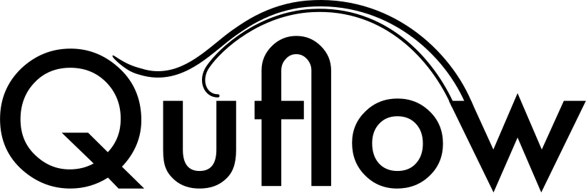

<p align="center">
  <picture>
    <source media="(prefers-color-scheme: dark)" srcset="docs/logo_mono_white.svg">
    
  </picture>
</p>

# quflow

A Python package for simulating two-dimensional incompressible fluids on the sphere
using *matrix hydrodynamics*: the 2-D fluid equations are discretized by quantization,
which replaces the vorticity field with an $N \times N$ skew-Hermitian matrix and the
incompressible Euler equations with an isospectral matrix flow.
The flow is integrated with Lie–Poisson (isospectral) methods,
which conserve the Casimir functions (including the enstrophy) up to rounding errors,
making the approach suitable for long-time simulations.

## Features

- Isospectral midpoint integrators for the quantized Euler equations, and classical
  Runge–Kutta methods for comparison.
- Fast $O(N^2)$ solvers for the quantized Laplacian (Poisson, Helmholtz, heat and
  viscosity/damping equations), and an experimental CUDA implementation.
- Conversions between vorticity matrices, spherical-harmonic coefficients and function
  values on the sphere.
- Forcing, viscosity and damping, time-dependent Hamiltonians, transported tracer fields,
  and magnetohydrodynamics (MHD).
- Simulation files in HDF5 format (`QuSimulation`) that store states, logged quantities
  and the solver settings, so that simulations can be continued, also on a cluster.
- Plots and animations of the vorticity on the sphere.

## Installation

The package may be installed directly from the repository:
```
git clone https://github.com/kmodin/quflow.git
cd quflow
pip install .
```

Alternatively, it can be installed via the included `conda` environment
description file `quflow-env.yaml`. A new conda environment named `quflow`
can be created with
```
conda env create -f quflow-env.yaml
```
The environment uses the default BLAS/LAPACK from conda-forge (OpenBLAS), which works on all platforms.
For a significant speed-up, switch to a hardware-optimized BLAS after creating the environment.

On a Mac with Apple Silicon, use the [latest version of Apple's Accelerate](https://conda-forge.org/news/2025/07/31/new-accelerate-macos/):
```
conda install -n quflow "libblas=*=*_newaccelerate"
```
On x86_64 hardware (Linux or Windows), use Intel MKL:
```
conda install -n quflow "libblas=*=*mkl"
```

### Dependencies

Required: `numpy`, `scipy`, `numba`, `ducc0`, `h5py`, `appdirs`, `matplotlib`.

Optional:

- `tqdm`: progress bars during simulations;
- `cartopy`: map projections in plots;
- `ffmpeg`: animations;
- `pyssht`: alternative backend for the spherical-harmonic transforms;
- `cupy`: GPU (CUDA) computations;
- `pytest`: running the tests;
- `jupyter`, `ipywidgets`: the example notebooks;
- `sphinx`, `numpydoc`, `furo`: building the documentation.

## Quick start

Integrate a random large-scale vorticity field and check that the energy is conserved:
```python
import numpy as np
import quflow as qf

N = 128                                  # matrix size (spherical harmonics up to degree N-1)
rng = np.random.default_rng(0)
omega = np.zeros(N**2)
omega[1:100] = rng.standard_normal(99)   # random large-scale vorticity (degrees 1 to 9)
W = qf.shr2mat(omega, N=N)               # quantized vorticity matrix

E0 = qf.energy_euler(W)
W = qf.solve(W, dt=0.1*qf.hbar(N), simtime=2.0)
print("relative energy change:", abs(qf.energy_euler(W) - E0)/E0)

qf.plot(W)                               # vorticity on the sphere
```

To store a simulation in a file, use a `QuSimulation` object:
```python
sim = qf.QuSimulation("mysim.hdf5", overwrite=True, state=W,
                      loggers={'energy': qf.energy_euler, 'enstrophy': qf.enstrophy})
sim['dt'] = 0.1*qf.hbar(N)               # time step
sim['simtime'] = 2.0                     # total simulation time
sim['dt_out'] = 0.1                      # time between stored states
W = qf.solve(sim)                        # continue later with qf.solve(sim)

sim['energy']                            # logged energy at each stored state
qf.create_animation("mysim.mp4", sim['fun'])   # requires ffmpeg
```

The example notebooks [`notebooks/basic-example/basic-example.ipynb`](notebooks/basic-example/basic-example.ipynb)
and [`notebooks/basic-cluster-simulation/basic-cluster-simulation.ipynb`](notebooks/basic-cluster-simulation/basic-cluster-simulation.ipynb)
demonstrate more functionality: forcing, viscosity, time-dependent forcing,
tracers, MHD and cluster simulations.

## Conventions

- The vorticity matrix $W$ evolves by $\dot W = \frac{1}{\hbar}[P, W]$, where the stream
  matrix $P$ solves $\Delta_N P = W$ and $\hbar = 2/\sqrt{N^2-1}$ (`qf.hbar(N)`).
  Time steps `dt` are given in physical time units; a natural choice is a multiple of
  `qf.hbar(N)`.
- Spherical-harmonic coefficients are stored in vectors of length $N^2$ with index
  `el*(el+1) + m`. Note that the real spherical harmonics with $m < 0$ have the opposite
  sign of the common real form; see the documentation of `quflow.transforms`.

## Documentation

The API documentation is built with Sphinx from the repository root:
```
python -m sphinx -b html docs docs/_build/html
```
and is then found in `docs/_build/html/index.html`.

## Tests

Run the test suite from the repository root:
```
python -m pytest
```

## References

A good entry point for learning about matrix hydrodynamics is [5].
If you use quflow in your work, please cite the papers it is based on, [1]–[4].

1. K. Modin and M. Viviani. *Lie–Poisson methods for isospectral flows*,
   Found. Comput. Math., 20:889–921, 2020.
   [doi:10.1007/s10208-019-09428-w](https://doi.org/10.1007/s10208-019-09428-w)
2. K. Modin and M. Viviani. *A Casimir preserving scheme for long-time simulation of
   spherical ideal hydrodynamics*, J. Fluid Mech., 884:A22, 2020.
   [doi:10.1017/jfm.2019.944](https://doi.org/10.1017/jfm.2019.944)
3. P. Cifani, M. Viviani and K. Modin. *An efficient geometric method for incompressible
   hydrodynamics on the sphere*, J. Comput. Phys., 473:111772, 2023.
   [doi:10.1016/j.jcp.2022.111772](https://doi.org/10.1016/j.jcp.2022.111772)
4. K. Modin and M. Viviani. *Two-dimensional fluids via matrix hydrodynamics*,
   Arch. Rational Mech. Anal., 250:10, 2026.
   [doi:10.1007/s00205-025-02154-4](https://doi.org/10.1007/s00205-025-02154-4)
5. K. Modin and M. Viviani. *A brief introduction to matrix hydrodynamics*,
   J. Comput. Dyn., 14:17–35, 2026.
   [doi:10.3934/jcd.2026001](https://doi.org/10.3934/jcd.2026001)

<details>
<summary>BibTeX</summary>

```bibtex
@article{MoVi2020a,
  author = {Modin, K. and Viviani, M.},
  doi = {10.1007/s10208-019-09428-w},
  journal = {Found. Comput. Math.},
  pages = {889--921},
  title = {{L}ie-{P}oisson methods for isospectral flows},
  url = {https://doi.org/10.1007/s10208-019-09428-w},
  volume = {20},
  year = {2020},
}

@article{MoVi2020,
  author = {Modin, K. and Viviani, M.},
  doi = {10.1017/jfm.2019.944},
  journal = {J. Fluid Mech.},
  pages = {A22},
  title = {A {C}asimir preserving scheme for long-time simulation of spherical ideal hydrodynamics},
  url = {https://doi.org/10.1017/jfm.2019.944},
  volume = {884},
  year = {2020},
}

@article{CiViMo2022,
  author = {Cifani, P. and Viviani, M. and Modin, K.},
  doi = {10.1016/j.jcp.2022.111772},
  journal = {J. Comput. Phys.},
  pages = {111772},
  title = {An efficient geometric method for incompressible hydrodynamics on the sphere},
  url = {https://doi.org/10.1016/j.jcp.2022.111772},
  volume = {473},
  year = {2023},
}

@article{MoVi2026,
  title = {Two-dimensional fluids via matrix hydrodynamics},
  author = {Modin, K. and Viviani, M.},
  year = {2026},
  journal = {Arch. Rational Mech. Anal.},
  volume = {250},
  pages = {10},
  url = {https://doi.org/10.1007/s00205-025-02154-4},
  doi = {10.1007/s00205-025-02154-4},
}

@article{MoVi2026b,
  author = {Modin, K. and Viviani, M.},
  title = {A brief introduction to matrix hydrodynamics},
  year = {2026},
  volume = {14},
  pages = {17--35},
  journal = {J. Comput. Dyn.},
  url = {https://doi.org/10.3934/jcd.2026001},
  doi = {10.3934/jcd.2026001},
}
```
</details>

## License

quflow is released under the MIT License; see [LICENSE](LICENSE).
